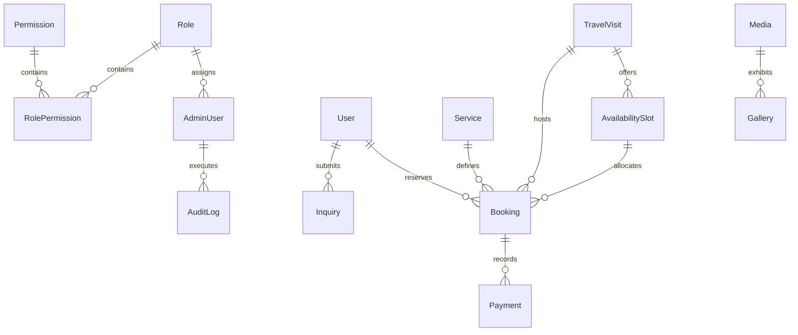

# Sugiyog — MySQL Database & Prisma Architecture

## 1. Engine & Database Standard

- **Engine**: MySQL 8.0+ / MariaDB 10.4+
- **Charset & Collation**: `utf8mb4` / `utf8mb4_unicode_ci` (full international multilingual support)
- **ORM**: Prisma Client v5.22.0
- **Timezone Discipline**: All stored datetimes are normalized in **UTC**. Local timezone identifiers (e.g. `Asia/Kolkata`, `America/New_York`) are stored explicitly on travel visits, bookings, and availability slots.
- **Monetary Types**: Strict `Decimal(10, 2)` types for all financial figures. Never floating-point values.

---

## 2. Entity Overview (16 Core Entities)

| # | Entity | Primary Key | Key Relationships / Indices | Soft Deletion |
|---|---|---|---|---|
| 1 | `User` | CUID (String) | One-to-many `Booking`, `Inquiry` | Yes (`deletedAt`) |
| 2 | `AdminUser` | CUID (String) | Many-to-one `Role`, one-to-many `AuditLog` | Yes (`deletedAt`) |
| 3 | `Role` | CUID (String) | One-to-many `AdminUser`, `RolePermission` | No |
| 4 | `Permission` | CUID (String) | Many-to-many with `Role` via `RolePermission` | No |
| 5 | `RolePermission` | CUID (String) | Compound unique `[roleId, permissionId]` | No |
| 6 | `Service` | CUID (String) | One-to-many `Booking` | Yes (`deletedAt`) |
| 7 | `TravelVisit` | CUID (String) | One-to-many `AvailabilitySlot`, `Booking` | Yes (`deletedAt`) |
| 8 | `AvailabilitySlot` | CUID (String) | Many-to-one `TravelVisit`, one-to-many `Booking` | No |
| 9 | `Booking` | CUID (String) | User, Service, TravelVisit, AvailabilitySlot, Payment | Yes (`deletedAt`) |
| 10 | `Payment` | CUID (String) | Many-to-one `Booking` | No |
| 11 | `Testimonial` | CUID (String) | Standalone client reflection records | Yes (`deletedAt`) |
| 12 | `Event` | CUID (String) | Standalone spiritual event records | Yes (`deletedAt`) |
| 13 | `Media` | CUID (String) | One-to-many `Gallery` | No |
| 14 | `Gallery` | CUID (String) | Many-to-one `Media` | No |
| 15 | `Inquiry` | CUID (String) | Optional many-to-one `User` | No |
| 16 | `SiteSettings` | CUID (String) | Standalone key-value records | No |
| 17 | `AuditLog` | CUID (String) | Many-to-one `AdminUser` | No |

---

## 3. Relational Architecture Diagram



---

## 4. Key Enums & Controlled Status Values

### `RoleName`
- `SUPER_ADMIN`: Root administrative privilege.
- `ADMIN`: General operational administration.
- `ASSISTANT`: Travel tours, city availability, and booking management for Swami Ji.
- `BOOKING_MANAGER`: Appointment verifications, rescheduling, and seeker support.
- `FINANCE_MANAGER`: Consultation dakshina, fee auditing, and payment receipts.
- `CONTENT_MANAGER`: Website articles, events, gallery, and testimonials.

### `BookingStatus`
- `PENDING`: Initial state for request-based submissions awaiting secretariat review.
- `CONFIRMED`: Time slot is locked and reserved for the seeker.
- `RESCHEDULED`: Appointment time adjusted.
- `COMPLETED`: Consultation successfully concluded.
- `CANCELLED`: Appointment cancelled.

### `PaymentStatus`
- `UNPAID`: Booking submitted without immediate fee clearance (e.g. offline dakshina).
- `PENDING`: Payment gateway transaction initiated.
- `PAID`: Fee transaction successfully cleared.
- `FAILED`: Payment gateway transaction failed.
- `REFUNDED`: Full or partial fee returned to seeker.

### `VisitStatus`
- `DRAFT`: Internal planning; hidden from public website and search filters.
- `PUBLISHED`: Visibly scheduled on public website with tour dates and city.
- `IN_PROGRESS`: Tour is currently underway.
- `COMPLETED`: Tour has concluded.
- `CANCELLED`: Tour cancelled or postponed.

---

## 5. Concurrency & Overbooking Prevention

For instant appointment bookings, overbooking is prevented via Prisma atomic transactions (`prisma.$transaction`):
1. The target `AvailabilitySlot` is queried inside the transaction.
2. Capacity is verified: `if (slot.bookedCount >= slot.capacity) throw 409 Conflict`.
3. The slot count is atomically incremented:
   ```javascript
   await tx.availabilitySlot.update({
     where: { id: slot.id },
     data: {
       bookedCount: slot.bookedCount + 1,
       status: (slot.bookedCount + 1) >= slot.capacity ? 'BOOKED' : 'AVAILABLE',
     },
   });
   ```
4. The `Booking` record is created referencing the reserved slot.
